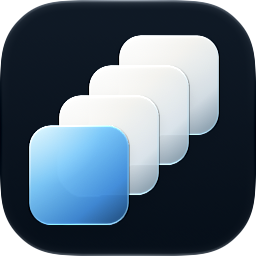

#  Raster

A small macOS menu-bar app. Pinned apps appear beside the Raster icon. A click opens the app, brings its window forward, or hides it when a window is already visible.

Requires macOS 14 or later. The interface is in English.

## Build

Xcode is required, for `swiftc` and Icon Composer.

```bash
./build.sh
```

That writes `Raster.app` in this folder. The app is signed only for this Mac, not for distribution. macOS may stop the first launch. Right-click the app and choose Open.

`Raster.app/` and `build/` are not committed.

## Access

Raster has no network access and no account.

- **The Dock list** is read once, the first time Raster has no list of its own, to pick up the apps you already pinned.
- **Accessibility** is used to see whether a window is minimized and to bring it forward. Without that permission the app still opens, but minimized windows cannot be brought forward. You are asked the first time it is needed.
- **Control of other apps** is used when you click or choose open, hide, or quit.

What is stored stays in Raster’s own settings on this Mac. The full explanation is in the app under Privacy, and in [PrivacyPolicy.txt](PrivacyPolicy.txt).

## Security

See [SECURITY.md](SECURITY.md).
